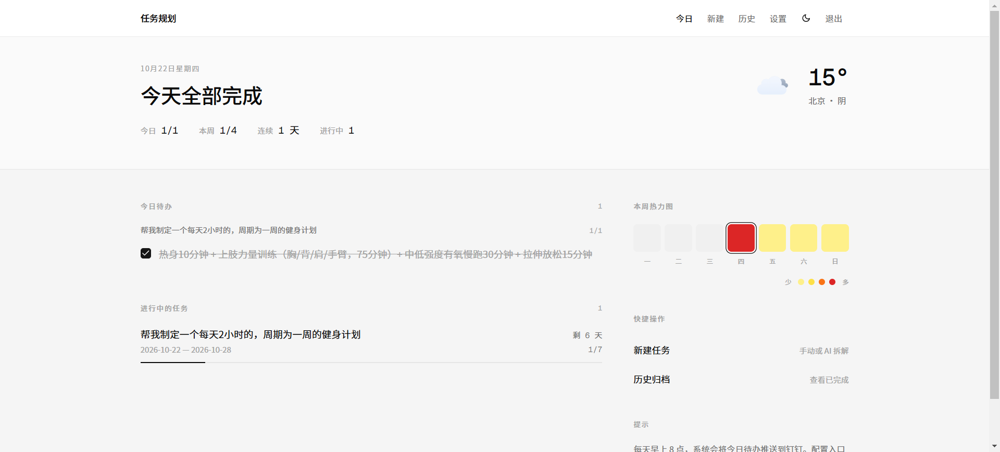
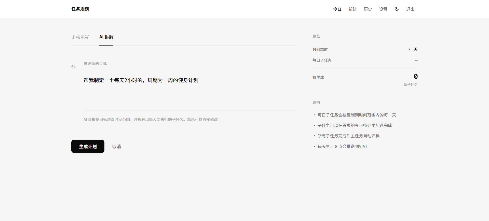
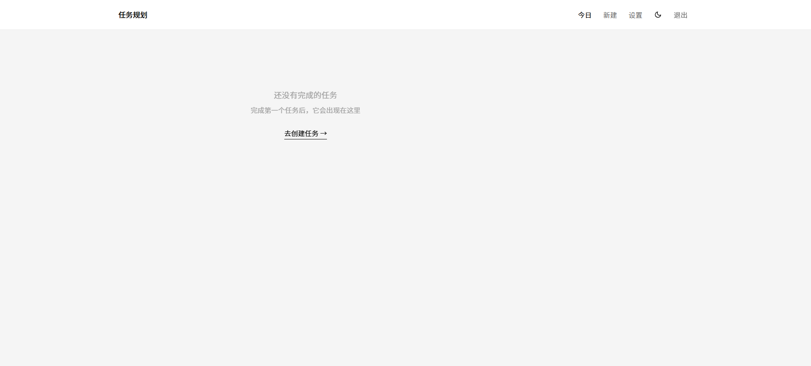
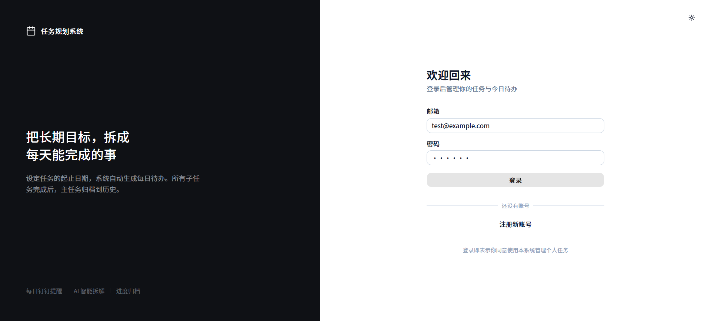

# 🚀 AI Task Planner (智能任务规划系统)

> 基于 Next.js + Express + PostgreSQL 的全栈 AI 任务管理系统。把宏大目标拆解为每日可执行的子任务，配合数据看板与钉钉自动化推送，助你建立持续的执行力。

🔗 **在线体验地址**: [http://60.205.131.152](http://60.205.131.152) (测试账号: `test@example.com` / 密码: `123456`)

## 📸 界面预览

| 首页数据看板 | AI 智能拆解任务 |
| :---: | :---: |
|  |  |

| 历史归档 | 暗黑模式支持 |
| :---: | :---: |
|  |  |

## ✨ 核心功能

- **🤖 AI 智能拆解**：接入 DeepSeek 大模型，根据用户输入的长期目标（如“三个月备考”），自动生成合理的起止时间，并拆解为按天分布的具体任务清单。
- **📅 双模式任务管理**：支持“每日重复”与“按天定制”两种任务生成模式，满足不同场景需求。
- **📊 数据看板与热力图**：首页提供今日/本周完成率、连续打卡统计，以及类似 GitHub 的活跃度热力图。
- **🔔 钉钉自动化推送**：支持配置自定义钉钉机器人 Webhook。每日定时（通过 node-cron）将当天的未完成待办推送至钉钉群，实现“系统主动找人”。
- **🌤️ 天气动态感知**：基于 IP 或浏览器定位，结合 Open-Meteo API 与 Lottie 动画展示实时天气。
- **🎨 极简美学设计**：基于 Tailwind CSS + shadcn/ui，支持亮/暗主题无缝切换，PC/移动端响应式适配。

## 🛠️ 技术栈

- **前端**: Next.js 14 (App Router), React, TypeScript, Tailwind CSS, shadcn/ui, next-themes, axios.
- **后端**: Node.js, Express, TypeScript, Drizzle ORM, JWT (bcryptjs).
- **数据库**: PostgreSQL (Neon Serverless).
- **部署与运维**: 阿里云 ECS, Nginx (反向代理), PM2 (进程守护), Neon (云数据库).

## 🏗️ 系统架构图

```text
[ 浏览器客户端 (Next.js) ]
       │
       ▼ (HTTP 请求 80端口)
[ Nginx 反向代理服务器 ]
       │
       ├──▶ (location /)    ──▶ [ PM2 守护: Next.js (Port 3000) ]
       │
       └──▶ (location /api) ──▶ [ PM2 守护: Express API (Port 3001) ]
                                        │
                                        ├──▶ [ Neon 云端 PostgreSQL ]
                                        │
                                        ├──▶ [ DeepSeek API (AI 拆解) ]
                                        │
                                        └──▶ [ 钉钉机器人 Webhook (每日推送) ]


<!-- 本地运行指南 -->

git clone https://github.com/jianyx/yxjiangm.git

cd api
npm install
# 配置 .env 文件 (参考 .env.example)
npm run dev


##  启动后端
cd api
npm install
# 配置 .env 文件 (参考 .env.example)
npm run dev

##  启动前端

cd ../web
npm install
# 配置 .env.local 文件 (NEXT_PUBLIC_API_BASE=http://localhost:3001)
npm run dev